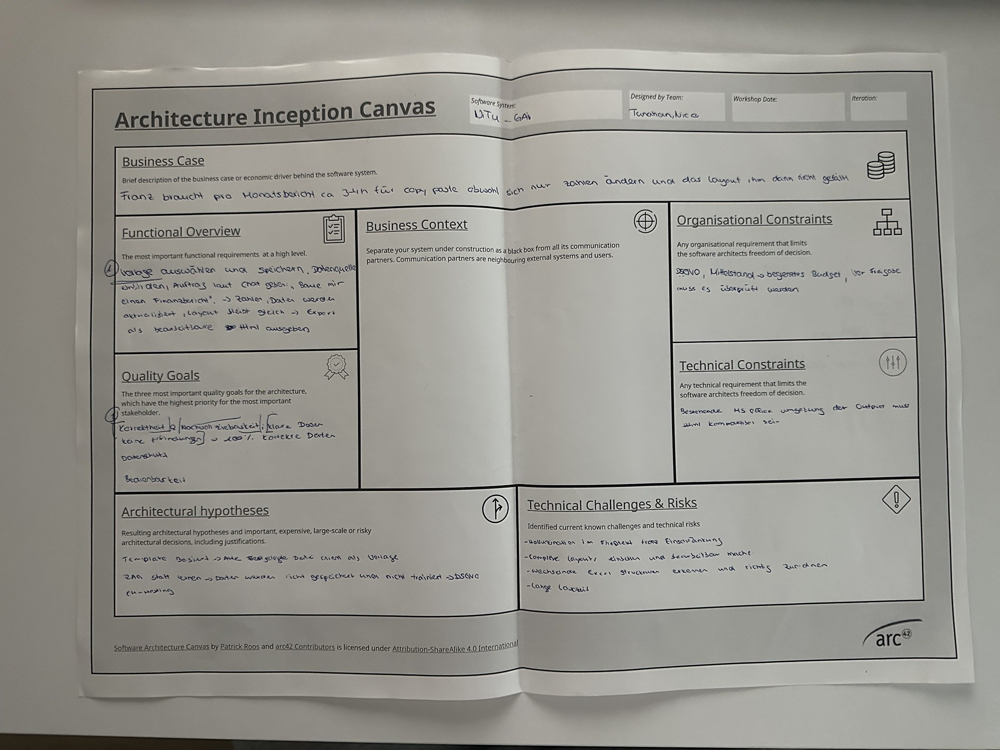

# Architecture Inception Canvas (arc42)

Stand: Analyse-Session vom 18.11.2026 · Designed by Team: Turahan, Nico · Software System: NiTu-GA (KI-Berichtsgenerator)

## 1 Business Case

Franz braucht ca. 3–4 Stunden pro Monatsbericht für Copy-Paste, obwohl sich nur die Zahlen ändern,
und das Layout gefällt ihm danach trotzdem nicht.

## 2 Functional Overview

1. Vorlage auswählen und speichern
2. Datenquelle anfügen
3. Auftrag per Chat geben („Baue mir einen Finanzbericht“)
4. Zahlen und Daten werden aktualisiert, das Layout bleibt gleich
5. Export als bearbeitbares HTML

## 3 Quality Goals

| Prio | Qualitätsziel | Messbares Kriterium |
|---|---|---|
| 1 | Korrektheit & Nachvollziehbarkeit (klare Daten, keine Erfindungen) | 100 % korrekte Daten |
| 2 | Datenschutz | offen, siehe Issue #3 |
| 3 | Bedienbarkeit | offen, siehe Issue #3 |

## 4 Business Context

Noch leer, siehe Issue #2.

## 5 Organisational Constraints

- DSGVO
- Mittelstand, daher begrenztes Budget
- Vor der Freigabe muss der Bericht überprüft werden

## 6 Technical Constraints

- Bestehende MS-Office-Umgebung
- Output muss HTML-kompatibel sein

## 7 Architectural Hypotheses

Laut Anleitung bleibt dieses Feld in der Analyse eigentlich leer (wird später mit C4/ADR ausgearbeitet).
Bereits notierte Ideen:

- Template-basiert: alte Datei dient als Vorlage
- RAG statt Training: Daten werden nicht gespeichert und nicht trainiert, daher DSGVO-freundlich
- EU-Hosting

## 8 Technical Challenges & Risks

- Halluzination im Fließtext trotz Einschränkung (Issue #4)
- Komplexe Layouts erhalten und bearbeitbar machen
- Wechselnde Excel-Strukturen erkennen und richtig zuordnen (Issue #5)
- Lange Laufzeit

## Notizen & offene Fragen

- Ist das Sprachmodell Teil des Systems oder ein Nachbarsystem?
- Welche Datenquellen werden unterstützt (xlsx, csv, ERP-Export)?
- Wer prüft und gibt den Bericht frei?
