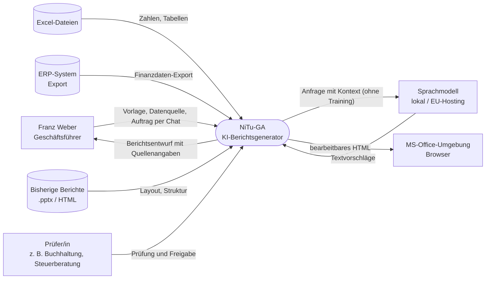

# Architecture Inception Canvas (arc42)

Stand: Analyse-Session vom 18.11.2026 · Designed by Team: Turahan, Nico · Software System: NiTu-GA (KI-Berichtsgenerator)

## 1 Business Case

Franz braucht ca. 3–4 Stunden pro Monatsbericht für Copy-Paste, obwohl sich nur die Zahlen ändern,
und das Layout gefällt ihm danach trotzdem nicht.

## 2 Functional Overview

1. Vorlage auswählen und speichern
2. Datenquelle anfügen
3. Auftrag per Chat geben („Baue mir einen Finanzbericht“)
4. Zahlen und Daten werden aktualisiert, das Layout bleibt gleich
5. Export als bearbeitbares HTML

## 3 Quality Goals

| Prio | Qualitätsziel | ISO 25010 | Measure (Kurzform) |
|---|---|---|---|
| 1 | Korrektheit & Nachvollziehbarkeit | Funktionale Eignung (funktionale Korrektheit), Sicherheit (Nachweisbarkeit) | 100 % der Zahlen stimmen mit der Quelle überein und haben eine Quellenangabe |
| 2 | Datenschutz | Sicherheit (Vertraulichkeit) | 0 Firmendaten verlassen die freigegebene Umgebung (Unternehmen bzw. EU-Hosting) |
| 3 | Bedienbarkeit | Benutzbarkeit (Erlernbarkeit, Bedienbarkeit) | Erster Bericht ohne Schulung in ≤ 10 Minuten, Folgeberichte in ≤ 5 Minuten |

### Qualitätsszenario Q1: Korrektheit & Nachvollziehbarkeit

| Teil | Inhalt |
|---|---|
| Merkmal | Funktionale Korrektheit, Nachweisbarkeit |
| Umgebung | Normalbetrieb zum Monatsabschluss, Vorlage und aktuelle Excel-Datei sind hinterlegt |
| Stimulus | Franz beauftragt per Chat: „Baue mir den Finanzbericht für Oktober.“ |
| Response | Das System übernimmt alle Zahlen ausschließlich aus der Datenquelle und zeigt zu jeder Zahl Datei, Blatt und Zelle an. Findet es einen Wert nicht, markiert es die Stelle, statt einen Wert zu erfinden. |
| Measure | 100 % der Zahlen im Bericht stimmen mit der Quelle überein, 100 % haben eine Quellenangabe, 0 erfundene Zahlen im Fließtext (Stichprobe an 3 Testberichten) |

### Qualitätsszenario Q2: Datenschutz

| Teil | Inhalt |
|---|---|
| Merkmal | Vertraulichkeit |
| Umgebung | Normalbetrieb, Verarbeitung von Finanz- und Personaldaten des Unternehmens |
| Stimulus | Franz lädt eine Excel-Datei mit Umsatz- und Gehaltsdaten hoch und erstellt einen Bericht |
| Response | Die Daten werden nur innerhalb der freigegebenen Umgebung verarbeitet, nicht zum Training verwendet und nach Abschluss des Auftrags nicht dauerhaft gespeichert (außer auf ausdrücklichen Wunsch) |
| Measure | 0 Datenübertragungen an Ziele außerhalb der freigegebenen Umgebung (Prüfung per Netzwerk-Log), Löschung der Rohdaten innerhalb von 24 h nach Auftragsende |

### Qualitätsszenario Q3: Bedienbarkeit

| Teil | Inhalt |
|---|---|
| Merkmal | Erlernbarkeit, Bedienbarkeit |
| Umgebung | Erste Nutzung am Büro-PC, Franz kennt Excel und PowerPoint, hat keine Schulung für das Tool |
| Stimulus | Franz will aus seinem letzten Monatsbericht und der neuen Excel-Datei den aktuellen Bericht erstellen |
| Response | Das System führt ihn in maximal 3 Schritten (Vorlage, Datenquelle, Auftrag) zum fertigen Bericht, ohne Fachbegriffe wie „Prompt“ oder „Mapping“ |
| Measure | Erster Bericht in ≤ 10 Minuten ohne Hilfe, jeder weitere in ≤ 5 Minuten (heute 3–4 Stunden), 0 Rückfragen an den Support im Test mit 3 Personen |

## 4 Business Context

Das System NiTu-GA wird als Blackbox betrachtet. Das Sprachmodell (LLM) behandeln wir als Nachbarsystem,
weil es als eigener Dienst betrieben wird (lokal oder EU-gehostet) und austauschbar sein soll.

| Kommunikationspartner | Art | Eingabe ins System | Ausgabe aus dem System |
|---|---|---|---|
| Franz Weber (Geschäftsführer) | Nutzer | Vorlage, Datenquelle, Chat-Auftrag, Korrekturen | Berichtsentwurf, Quellenangaben, Rückfragen |
| Prüfer/in (Buchhaltung, Steuerberatung) | Nutzer | Freigabe oder Korrekturhinweis | Bericht mit Quellen zur Prüfung |
| Excel-Dateien | Nachbarsystem | Zahlen und Tabellen | – |
| ERP-System | Nachbarsystem | Export der Finanzdaten (z. B. csv/xlsx) | – |
| Bisherige Berichte | Nachbarsystem | Layout und Struktur als Vorlage | – |
| Sprachmodell | Nachbarsystem | Textvorschläge | Anfrage mit Kontext, keine Trainingsdaten |
| MS-Office-Umgebung / Browser | Nachbarsystem | – | bearbeitbares HTML |

## 5 Organisational Constraints

- DSGVO
- Mittelstand, daher begrenztes Budget
- Vor der Freigabe muss der Bericht überprüft werden

## 6 Technical Constraints

- Bestehende MS-Office-Umgebung
- Output muss HTML-kompatibel sein

## 7 Architectural Hypotheses

Laut Anleitung bleibt dieses Feld in der Analyse eigentlich leer (wird später mit C4/ADR ausgearbeitet).
Bereits notierte Ideen:

- Template-basiert: alte Datei dient als Vorlage
- RAG statt Training: Daten werden nicht gespeichert und nicht trainiert, daher DSGVO-freundlich
- EU-Hosting

## 8 Technical Challenges & Risks

- Halluzination im Fließtext trotz Einschränkung (Issue #4)
- Komplexe Layouts erhalten und bearbeitbar machen
- Wechselnde Excel-Strukturen erkennen und richtig zuordnen (Issue #5)
- Lange Laufzeit

## Notizen & offene Fragen

- Entschieden: Das Sprachmodell ist ein Nachbarsystem (siehe Business Context).
- Welche Datenquellen werden unterstützt (xlsx, csv, ERP-Export)?
- Wer prüft und gibt den Bericht frei?
