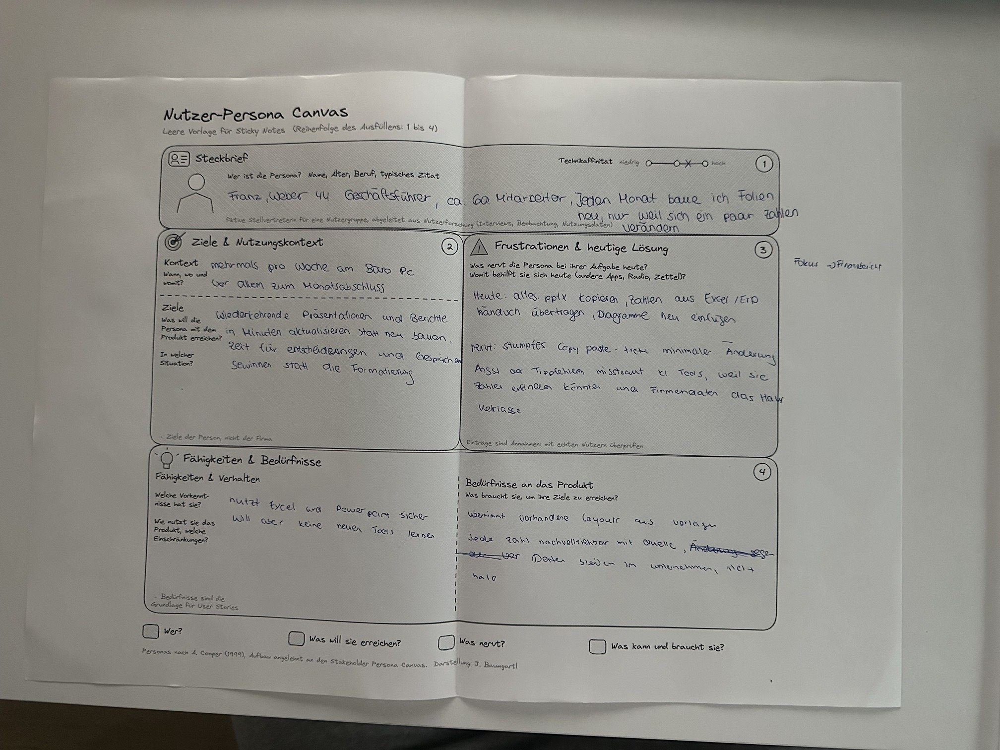

# Nutzer-Persona Canvas

Stand: Analyse-Session vom 18.11.2026 · Team: Turahan, Nico · Fokus: Finanzbericht

## 1 Steckbrief

| | |
|---|---|
| **Name** | Franz Weber |
| **Alter** | 44 |
| **Beruf** | Geschäftsführer, ca. 60 Mitarbeiter |
| **Technikaffinität** | mittel bis hoch |
| **Typisches Zitat** | „Jeden Monat baue ich Folien neu, nur weil sich ein paar Zahlen verändern.“ |

## 2 Ziele & Nutzungskontext

**Kontext (wann, wo, womit?)**
- Mehrmals pro Woche am Büro-PC, vor allem zum Monatsabschluss.

**Ziele (was will die Persona mit dem Produkt erreichen?)**
- Wiederkehrende Präsentationen und Berichte in Minuten aktualisieren statt neu bauen.
- Zeit für Entscheidungen und Gespräche gewinnen statt für die Formatierung.

**Messbares Erfolgskriterium**
- Monatsbericht in ≤ 10 Minuten statt heute 3–4 Stunden, ohne dass eine Zahl von Hand korrigiert werden muss.

## 3 Frustrationen & heutige Lösung

**Heute (womit behilft sie sich?)**
- Alte .pptx kopieren, Zahlen aus Excel/ERP händisch übertragen, Diagramme neu einfügen.

**Was nervt?**
- Stumpfes Copy-Paste trotz minimaler Änderung.
- Angst vor Tippfehlern.
- Misstraut KI-Tools, weil sie Zahlen erfinden könnten und Firmendaten das Haus verlassen.

## 4 Fähigkeiten & Bedürfnisse

**Fähigkeiten & Verhalten**
- Nutzt Excel und PowerPoint sicher.
- Will aber keine neuen Tools lernen.

**Bedürfnisse an das Produkt**
- Übernimmt vorhandene Layouts aus der Vorlage.
- Jede Zahl ist mit ihrer Quelle nachvollziehbar.
- Daten bleiben im Unternehmen.

## Beziehungen zwischen den Feldern

| Von | Beziehung | Nach |
|---|---|---|
| 4 Bedürfnis „Jede Zahl nachvollziehbar mit Quelle“ | **löst** | 3 „Angst vor Tippfehlern“ und „misstraut KI-Tools, die Zahlen erfinden“ |
| 4 Bedürfnis „Daten bleiben im Unternehmen“ | **löst** | 3 „Firmendaten verlassen das Haus“ |
| 4 Bedürfnis „Übernimmt vorhandene Layouts aus Vorlage“ | **unterstützt** | 2 Ziel „Zeit für Entscheidungen statt Formatierung“ |
| 4 Fähigkeit „Will keine neuen Tools lernen“ | **gefährdet** | 2 Ziel „Berichte in Minuten aktualisieren“ |
